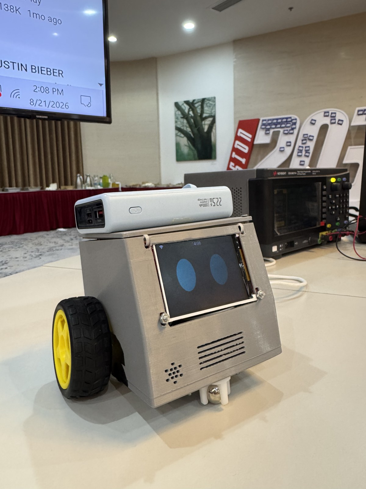

# Desktop AI Buddy

ESP32-S3 firmware for a **desk voice companion on wheels**: full-screen face, English voice on [xiaozhi.me](https://xiaozhi.me), and short safe wheel motions as character — not a mapping rover.

This repo is a fork of [78/xiaozhi-esp32](https://github.com/78/xiaozhi-esp32) (Xiaozhi / 小智 AI). We keep the upstream voice stack and add a custom board + motors + face. The only board we ship and flash is **`desktop-robot`**.

(English | [中文](README_zh.md))

<p align="center">
  
</p>

**Demo video (~44 s):** [Watch on Google Drive](https://drive.google.com/file/d/1nBvJBAVfND-i_Tvr9Yp2zcVKm53141Sx/view?usp=sharing)  
(Full MP4 ~45 MB stays on Drive; in-repo assets: `docs/media/desktop_robot_photo.jpg`, `docs/media/desktop_demo_poster.jpg`.)

## Related repositories

| Repo | Role |
|---|---|
| **This repo** — [Timthn/Desktop_AI_buddy](https://github.com/Timthn/Desktop_AI_buddy) | Firmware (ESP-IDF / Xiaozhi fork) |
| **Full documentation** — [Timthn/Desktop_robot_documentation-](https://github.com/Timthn/Desktop_robot_documentation-) | Product, hardware, wiring, power, chassis, software spec, todos |

## Documentation (source of truth)

Product, hardware, wiring, power, chassis, software spec, and todos live in the **full documentation** repo:

**→ [Timthn/Desktop_robot_documentation-](https://github.com/Timthn/Desktop_robot_documentation-)**

| Doc | What |
|---|---|
| [PRD](https://github.com/Timthn/Desktop_robot_documentation-/blob/main/02-product/prd.md) | Product goals and non-goals |
| [Software spec v0](https://github.com/Timthn/Desktop_robot_documentation-/blob/main/05-software/software-spec-v0.md) | Firmware phases, MCP, bring-up tests |
| [Pin config](https://github.com/Timthn/Desktop_robot_documentation-/blob/main/03-hardware/hardware_doc/pin-config.md) | GPIO map |
| [Power design](https://github.com/Timthn/Desktop_robot_documentation-/blob/main/03-hardware/power-design.md) | Battery schematic + desk dual-5 V setup |
| [Wiring SVG](https://github.com/Timthn/Desktop_robot_documentation-/blob/main/03-hardware/wiring.svg) | Physical solder reference |
| [Role prompt](https://github.com/Timthn/Desktop_robot_documentation-/blob/main/05-software/xiaozhi-role-prompt.md) | Paste into xiaozhi.me |
| [Vietnam demo KB](https://github.com/Timthn/Desktop_robot_documentation-/blob/main/05-software/demo-knowledge-base-vietnam.md) | Demo knowledge base |
| [Developer todo](https://github.com/Timthn/Desktop_robot_documentation-/blob/main/05-software/developer.todo.md) | Human-in-the-loop checklist |
| [Agent todo](https://github.com/Timthn/Desktop_robot_documentation-/blob/main/05-software/agent.todo.md) | Firmware coding order |

If this README and the docs disagree, **the docs repo wins**.

## Project background

The goal is a **small robot that sits on a desk**, talks like Xiaozhi, shows big-eye emotions on a 2.8″ ST7789, and wiggles a few centimetres when you ask it to move. Voice is the product; wheels are expression.

We chose **not** to rewrite ASR / LLM / TTS / WebSocket. Those stay on official **xiaozhi.me**. This firmware fork only owns:

- a new board identity (`desktop-robot`) so OTA does not collide with upstream boards
- pins for the hardware we actually soldered
- motors + MCP tools the cloud model can call
- our own face PNGs mapped from the cloud `emotion` field

Hardware is breadboard / DevKit based (ESP32-S3 + TB6612 + INMP441 + MAX98357A + ST7789), not a custom PCB. Design and bring-up notes are all in the [documentation repo](https://github.com/Timthn/Desktop_robot_documentation-).

## What we added on top of Xiaozhi

Upstream Xiaozhi already gives Wi-Fi provisioning, wake word, cloud voice, LCD UI, and device MCP. Relative to a stock XiaoZhi board (we started from `bread-compact-wifi-lcd`), this fork adds:

| Area | Addition | Where |
|---|---|---|
| **Board** | New `desktop-robot` type (unique OTA / board name). LCD RST **GPIO39**, landscape **320×240**, invert locked for this panel | `main/boards/desktop-robot/` |
| **Motors** | TB6612 open-loop driver: queue, STBY only while moving, duty %, duration caps, polarity invert flags | `motor_driver.*` |
| **MCP tools** | `self.robot.move` (actions + `duration_ms` + `duty_percent` + `sequence`), `self.robot.stop`, `self.robot.quiet` (abort TTS, keep listening), `self.robot.standby` (back to wake-word idle) | `desktop_robot_board.cc` |
| **Face** | 21 embedded PNGs; cloud `emotion` → `SetEmotion` (no Xiaozhi `assets.bin` / `USE_EMOTE_MESSAGE_STYLE`) | `robot_faces.*`, `main/assets/faces/` |
| **Battery hook** | `AdcBatteryMonitor` on GPIO1 + low-battery motor lock (flags off until divider is soldered) | `config.h` + board init |
| **TLS workaround** | Patch to skip hostname check for official `api.tenclass.net` cert mismatch | `patches/esp-ml307-skip-hostname.patch` |
| **CI** | Manual-only workflow so private-repo pushes do not build all upstream boards | `.github/workflows/build.yml` |

**Intentionally unchanged (still Xiaozhi):** Application loop, ESP-SR wake, Opus / WebSocket / MQTT voice path, xiaozhi.me account model, other upstream boards in the tree (CMake builds only the selected one).

**Not in this firmware (docs / cloud):** role prompt, Vietnam demo knowledge base, chassis STLs — those live in the [docs repo](https://github.com/Timthn/Desktop_robot_documentation-) and on xiaozhi.me.

## Current desk setup

| Piece | Now |
|---|---|
| Chip / board | ESP32-S3 DevKitC-1 N16R8 · type `desktop-robot` |
| Voice | xiaozhi.me · English · wake **Hi ESP** · greeting *Hey, I'm here.* |
| Face | 21 PNGs on device; chat + status bar still visible |
| Motors | Duty **50%** (`duty_percent` 25–80) · max **8 s** · F/B + turns accepted on desk |
| Battery ADC | Code ready · **off** until GPIO1 divider is soldered |
| Desk power | **USB plugged** (logic / LCD) + **Type-C rewired as 5 V** into motor `VM` — pack-only 18650 flickers the LCD |

Do **not** edit `bread-compact-wifi-lcd` in place. Do **not** firmware-swap left/right wheels; L/R is a [role-prompt map](https://github.com/Timthn/Desktop_robot_documentation-/blob/main/05-software/xiaozhi-role-prompt.md).

**Status (2026-08-24):** landscape LCD, face v0, speaker, cloud voice, and motors are working on the desk. Vietnam KB + role prompt are on xiaozhi.me. Next: battery divider (T6), optional ceremony speech, later hide chat/status.

## Build & flash

Prefer **ESP-IDF v6.0.2**.

```bash
python scripts/build.py --list-boards
python scripts/build.py desktop-robot --name desktop-robot
```

This desk unit: port **COM5**, `--before usb-reset`. After Wi-Fi is in NVS, flash **app only** at `0x20000` (`build/xiaozhi.bin`) so credentials stay. Do not hold BOOT while flashing.

After any `esp-ml307` Component Manager refresh, re-apply `patches/esp-ml307-skip-hostname.patch` (`managed_components/` is gitignored). See docs spec §4.4.

## Board folder

```
main/boards/desktop-robot/
  config.h / config.json
  desktop_robot_board.cc   # display, MCP, battery hook
  motor_driver.*           # TB6612 open-loop
  robot_faces.*            # emotion → PNG
  README.md
```

## Cloud setup

1. Provision Wi-Fi (phone **2.4 GHz** hotspot → board AP → `http://192.168.4.1`)
2. Wake **Hi ESP** → bind the 6-digit code on [xiaozhi.me](https://xiaozhi.me)
3. Paste [xiaozhi-role-prompt.md](https://github.com/Timthn/Desktop_robot_documentation-/blob/main/05-software/xiaozhi-role-prompt.md)
4. Demo KB: [demo-knowledge-base-vietnam.md](https://github.com/Timthn/Desktop_robot_documentation-/blob/main/05-software/demo-knowledge-base-vietnam.md)

## Upstream XiaoZhi docs (still useful)

- [Custom board](docs/custom-board.md)
- [MCP usage](docs/mcp-usage.md)
- [WebSocket](docs/websocket.md) · [MQTT + UDP](docs/mqtt-udp.md)
- [ESP-IDF 6 migration](docs/esp-idf-6-migration.md)

Upstream: [78/xiaozhi-esp32](https://github.com/78/xiaozhi-esp32).

## License

MIT, same as upstream Xiaozhi.
# robot-the-talker-Car

