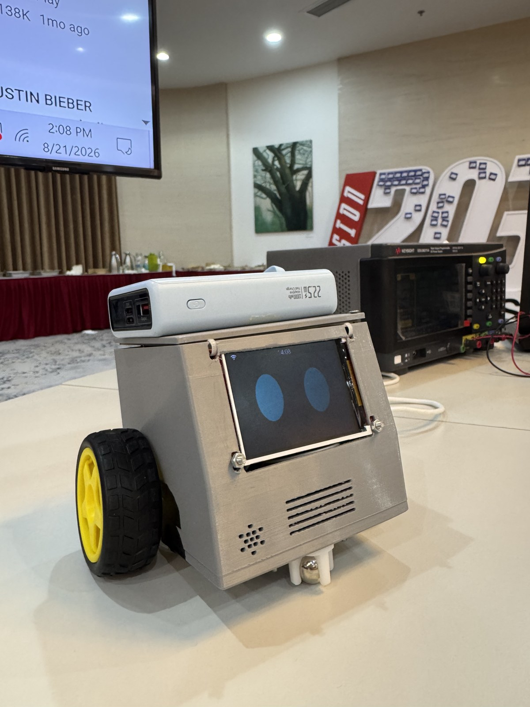

# Desktop AI Buddy

桌上語音陪伴機器人的 **ESP32-S3 韌體**：全螢幕表情、[xiaozhi.me](https://xiaozhi.me) 英文對話、短距離輪子動作當「個性」——不是導航小車。

本倉庫是 [78/xiaozhi-esp32](https://github.com/78/xiaozhi-esp32)（小智 AI）的 fork。我們保留上游語音棧，加上自訂板型、馬達與表情。實際燒錄與維護的板型只有 **`desktop-robot`**。

（中文 | [English](README.md)）

<p align="center">
  
</p>

**演示影片（約 44 秒）：** [在 Google Drive 觀看](https://drive.google.com/file/d/1nBvJBAVfND-i_Tvr9Yp2zcVKm53141Sx/view?usp=sharing)  
（完整 MP4 約 45 MB 放在 Drive；倉庫內：`docs/media/desktop_robot_photo.jpg`、`docs/media/desktop_demo_poster.jpg`。）

## 相關倉庫

| 倉庫 | 用途 |
|---|---|
| **本倉庫** — [Timthn/Desktop_AI_buddy](https://github.com/Timthn/Desktop_AI_buddy) | 韌體（ESP-IDF / 小智 fork） |
| **完整文檔** — [Timthn/Desktop_robot_documentation-](https://github.com/Timthn/Desktop_robot_documentation-) | 產品、硬體、接線、電源、外殼、軟體 spec、todo |

## 文檔倉庫（產品真相來源）

產品、硬體、接線、電源、外殼、軟體 spec、todo 都在**完整文檔倉庫**：

**→ [Timthn/Desktop_robot_documentation-](https://github.com/Timthn/Desktop_robot_documentation-)**

| 文檔 | 內容 |
|---|---|
| [PRD](https://github.com/Timthn/Desktop_robot_documentation-/blob/main/02-product/prd.md) | 產品目標與非目標 |
| [Software spec v0](https://github.com/Timthn/Desktop_robot_documentation-/blob/main/05-software/software-spec-v0.md) | 韌體階段、MCP、上電測試 |
| [Pin config](https://github.com/Timthn/Desktop_robot_documentation-/blob/main/03-hardware/hardware_doc/pin-config.md) | GPIO 對照 |
| [Power design](https://github.com/Timthn/Desktop_robot_documentation-/blob/main/03-hardware/power-design.md) | 電池原理圖 + 桌上雙 5 V 接法 |
| [Wiring SVG](https://github.com/Timthn/Desktop_robot_documentation-/blob/main/03-hardware/wiring.svg) | 實物焊接參考 |
| [角色 prompt](https://github.com/Timthn/Desktop_robot_documentation-/blob/main/05-software/xiaozhi-role-prompt.md) | 貼到 xiaozhi.me |
| [越南 demo KB](https://github.com/Timthn/Desktop_robot_documentation-/blob/main/05-software/demo-knowledge-base-vietnam.md) | Demo 知識庫 |
| [Developer todo](https://github.com/Timthn/Desktop_robot_documentation-/blob/main/05-software/developer.todo.md) | 人機協作 checklist |
| [Agent todo](https://github.com/Timthn/Desktop_robot_documentation-/blob/main/05-software/agent.todo.md) | 韌體實作順序 |

若本 README 與文檔衝突，**以文檔倉庫為準**。

## 項目背景

目標是一台**放在桌上的小機器人**：用小智的方式對話，在 2.8″ ST7789 上顯示大眼睛表情，你叫它動時就短距離轉一下。語音是產品主體，輪子是表情。

我們**不重寫** ASR / LLM / TTS / WebSocket，這些繼續走官方 **xiaozhi.me**。這個 fork 只負責：

- 新的板型身份（`desktop-robot`），避免 OTA 與上游板撞名
- 對應我們實際焊線的腳位
- 馬達 + 雲端模型可呼叫的 MCP 工具
- 自己的表情 PNG，對應雲端 `emotion` 欄位

硬體是 DevKit / 麵包板路線（ESP32-S3 + TB6612 + INMP441 + MAX98357A + ST7789），不是自製 PCB。設計與 bring-up 全寫在 [文檔倉庫](https://github.com/Timthn/Desktop_robot_documentation-)。

## 相對小智 AI，我們新加了什麼

上游小智已有配網、喚醒、雲端語音、LCD UI、設備端 MCP。相對於常見 donor 板（我們從 `bread-compact-wifi-lcd` 複製），本 fork 新增：

| 方向 | 新增內容 | 位置 |
|---|---|---|
| **板型** | 新 type `desktop-robot`（獨立 OTA／板名）。LCD RST **GPIO39**、橫屏 **320×240**、本屏 invert 鎖定 | `main/boards/desktop-robot/` |
| **馬達** | TB6612 開環驅動：佇列、僅移動時拉高 STBY、duty %、時長上限、極性 invert | `motor_driver.*` |
| **MCP 工具** | `self.robot.move`（動作 + `duration_ms` + `duty_percent` + `sequence`）、`stop`、`quiet`（停 TTS 但繼續聽）、`standby`（回到喚醒待機） | `desktop_robot_board.cc` |
| **表情** | 21 張內嵌 PNG；雲端 `emotion` → `SetEmotion`（不用小智 `assets.bin` / `USE_EMOTE_MESSAGE_STYLE`） | `robot_faces.*`、`main/assets/faces/` |
| **電池 hook** | GPIO1 上的 `AdcBatteryMonitor` + 低電鎖馬達（分壓未焊前 flag 關） | `config.h` + board init |
| **TLS 補丁** | 官方 `api.tenclass.net` 憑證主機名不符時的 skip patch | `patches/esp-ml307-skip-hostname.patch` |
| **CI** | 改手動觸發，避免 private repo 一 push 就編譯全部上游板 | `.github/workflows/build.yml` |

**刻意不改（仍是小智）：** Application 主循環、ESP-SR 喚醒、Opus／WebSocket／MQTT 語音路徑、xiaozhi.me 帳號模型、樹裡其他上游板型（CMake 只編選中的那一個）。

**不在本韌體裡（在文檔／雲端）：** 角色 prompt、越南 demo 知識庫、外殼 STL —— 見 [文檔倉庫](https://github.com/Timthn/Desktop_robot_documentation-) 與 xiaozhi.me。

## 目前桌上接法

| 項目 | 現況 |
|---|---|
| 晶片 / 板型 | ESP32-S3 DevKitC-1 N16R8 · type `desktop-robot` |
| 語音 | xiaozhi.me · 英文 · 喚醒 **Hi ESP** · 開場 *Hey, I'm here.* |
| 表情 | 21 張 PNG 已在板子上；聊天列 + 狀態列仍顯示 |
| 馬達 | Duty **50%**（`duty_percent` 25–80）· 最長 **8 秒** · 前進後退與轉彎桌上可用 |
| 電池 ADC | 程式已寫 · **關**，等 GPIO1 分壓焊好 |
| 桌上電源 | **USB 一直插**（邏輯／螢幕）+ **Type-C 改焊 5 V** 進馬達 `VM` — 純 18650 會讓螢幕閃 |

不要改 `bread-compact-wifi-lcd`。不要在韌體裡對換左右輪；左右靠 [角色 prompt](https://github.com/Timthn/Desktop_robot_documentation-/blob/main/05-software/xiaozhi-role-prompt.md) 對照。

**進度（2026-08-24）：** 橫屏、表情 v0、喇叭、雲端語音、馬達桌上可用。越南 KB + 角色 prompt 已上 xiaozhi.me。下一步：電池分壓（T6）、可選典禮講稿、之後再藏聊天列。

## 編譯與燒錄

建議 **ESP-IDF v6.0.2**。

```bash
python scripts/build.py --list-boards
python scripts/build.py desktop-robot --name desktop-robot
```

這台桌上機：埠 **COM5**，`--before usb-reset`。Wi-Fi 進 NVS 後只燒 **app**（`0x20000`，`build/xiaozhi.bin`）。燒錄時不要按住 BOOT。

每次 Component Manager 刷新 `esp-ml307` 後，重套 `patches/esp-ml307-skip-hostname.patch`（`managed_components/` 不進 git）。見文檔 spec §4.4。

## 板型目錄

```
main/boards/desktop-robot/
  config.h / config.json
  desktop_robot_board.cc   # 顯示、MCP、電池 hook
  motor_driver.*           # TB6612 開環
  robot_faces.*            # emotion → PNG
  README.md
```

## 雲端設定

1. 配網（手機 **2.4 GHz** 熱點 → 板子 AP → `http://192.168.4.1`）
2. 喊 **Hi ESP** → 在 [xiaozhi.me](https://xiaozhi.me) 綁定六位碼
3. 貼 [xiaozhi-role-prompt.md](https://github.com/Timthn/Desktop_robot_documentation-/blob/main/05-software/xiaozhi-role-prompt.md)
4. Demo KB：[demo-knowledge-base-vietnam.md](https://github.com/Timthn/Desktop_robot_documentation-/blob/main/05-software/demo-knowledge-base-vietnam.md)

## 上游小智文件（仍有用）

- [自定義板型](docs/custom-board_zh.md)
- [MCP 用法](docs/mcp-usage.md)
- [WebSocket](docs/websocket_zh.md) · [MQTT + UDP](docs/mqtt-udp_zh.md)
- [ESP-IDF 6 遷移](docs/esp-idf-6-migration.md)

上游：[78/xiaozhi-esp32](https://github.com/78/xiaozhi-esp32)。

## 授權

MIT，與上游小智相同。
